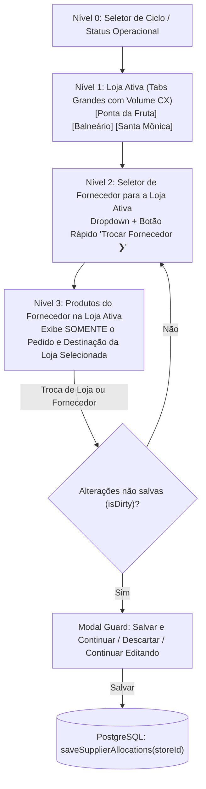
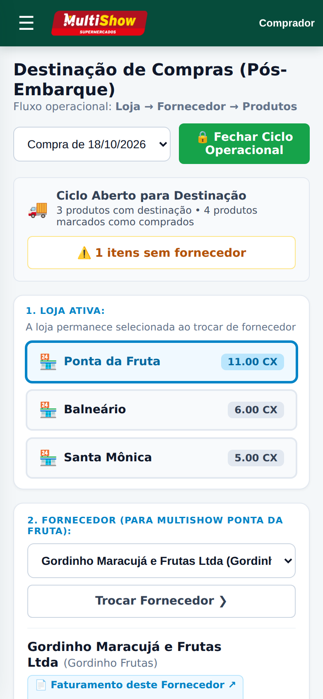
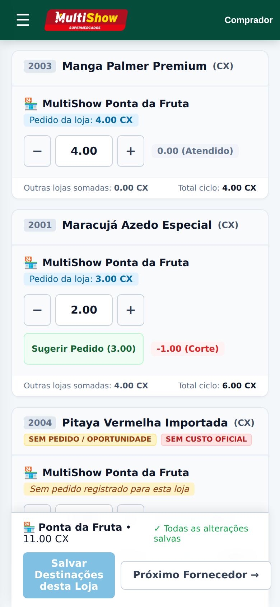
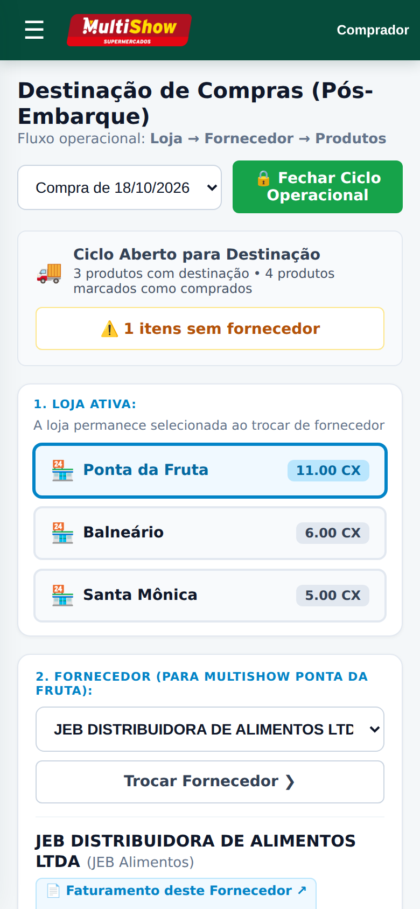
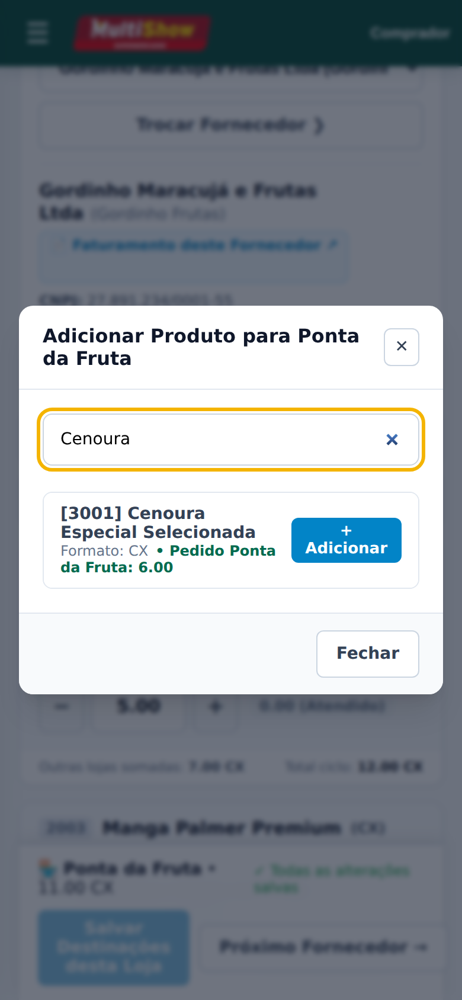
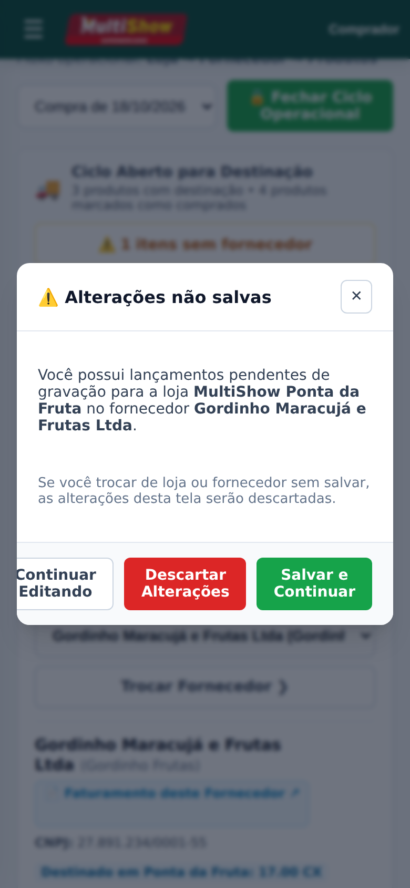
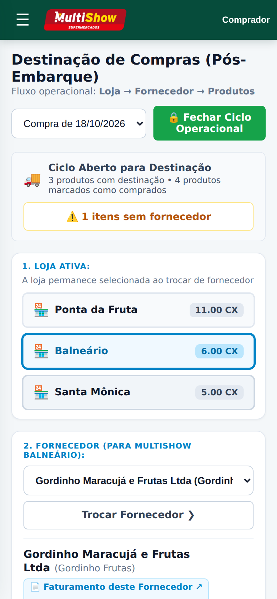

# MULTISHOW — RELATÓRIO DE HOMOLOGAÇÃO: AJUSTE DA NAVEGAÇÃO DA FASE 3

**Data de Conclusão:** 16 de Outubro de 2026  
**Branch de Desenvolvimento:** `feat/buyer-allocations-store-first` (commit `ee991bd`)  
**Status de Homologação:** APROVADO nos testes unitários (437/437), verificação de tipos e linter (0 warnings/erros).  
**Diretiva de Segurança:** NÃO mesclado na `main` e NÃO implantado em produção nesta etapa.

---

## 1. Sumário Executivo

Atendendo à nova regra operacional aprovada com os colaboradores e compradores do MultiShow, a tela de Destinação de Compras (`/comprador/destinacao`) foi reestruturada para seguir a hierarquia operacional:

$$\mathbf{LOJA} \longrightarrow \mathbf{FORNECEDOR} \longrightarrow \mathbf{PRODUTOS}$$

Adicionalmente, foi diagnosticado e sanado com sucesso o **Bug 01**: anteriormente, ao adicionar um produto comprado a partir do catálogo, a interface exibia pedido `0.00` até que a página fosse recarregada (F5). Com a nova arquitetura, o mapa completo de pedidos do ciclo (`cycleStoreOrders`) é transmitido de forma otimizada para o cliente, resolvendo imediatamente as quantidades solicitadas pela loja ativa no momento em que o item é adicionado.

---

## 2. Arquitetura da Nova Interface Mobile (3 Níveis)

### Detalhamento dos Componentes Operacionais:

1. **Nível 1 — Loja Ativa:**
   - 3 botões em destaque (`alloc-store-tab`), ideais para telas sensíveis ao toque (touch targets > 44px).
   - Cada botão exibe o nome simplificado da loja e o crachá com o volume total já destinado em caixas (`CX`).
   - A loja selecionada permanece fixa e ativa na URL (`?loja=<uuid>`), mesmo ao alternar entre múltiplos fornecedores.

2. **Nível 2 — Fornecedor:**
   - Posicionado imediatamente abaixo das lojas: `2. FORNECEDOR (PARA MULTISHOW [LOJA]):`.
   - Exibe no rótulo de cada fornecedor o volume específico destinado para a loja ativa (ex: *Gordinho Frutas — 11.00 CX nesta loja*).
   - Botão rápido de toque **"Trocar Fornecedor ❯"** permitindo ciclar os fornecedores daquela mesma loja sem perder o foco geográfico.

3. **Nível 3 — Painel de Produto com Foco Exclusivo na Loja:**
   - A área de edição exibe **apenas** o pedido da loja ativa (`Pedido da loja: X CX`), eliminando poluição visual e confusão de digitação no celular.
   - Controles táteis: botões `−` e `+` de fácil alcance, campo decimal numérico direto e botão inteligente **"Sugerir Pedido (X.00)"** que iguala o destinado ao pedido com um único toque quando houver diferença.
   - Pílula de diferença em tempo real: `-1.00 (Corte)` em vermelho, `+2.00 (Adicional)` em azul/verde, ou `0.00 (Atendido)` em cinza neutro.
   - Rodapé informativo discreto indicando: *Outras lojas somadas: Y CX • Total ciclo: Z CX*.

4. **Guarda de Alterações Não Salvas (*Unsaved Changes Guard*):**
   - Caso o comprador digite novos valores e tente mudar de loja ou fornecedor sem salvar, a tela intercepta a navegação e abre modal protetor com 3 opções:
     - **Salvar e Continuar:** persiste os dados da loja ativa e prossegue.
     - **Descartar Alterações:** reverte as alterações locais e prossegue.
     - **Continuar Editando:** fecha o modal e mantém o comprador na tela atual.

---

## 3. Resolução Técnica do Bug 01 (Resolução Imediata de Pedidos sem F5)

### Causa Raiz:
Anteriormente, o endpoint `readBuyerAllocationWorkspace` carregava pedidos consolidados e vinculados estaticamente. Ao buscar um produto pelo catálogo no cliente e adicioná-lo à grade do fornecedor via `handleAddProductFromCatalog`, o objeto de pedido era instanciado com `orderedQuantity: "0.00"` porque o cliente não possuía o mapa de pedidos dos itens que ainda não constavam na lista do fornecedor.

### Solução Aplicada:
1. No repositório [`repository.ts`](file:///var/www/compras.muitomaisatacado.com/.worktrees/buyer-allocations/src/modules/purchasing/allocations/repository.ts):
   - Adicionada a extração global de pedidos do ciclo: `cycleStoreOrders: Record<string, Record<string, string>>` mapeando `[productId][storeId] = quantidade`.
   - População do catálogo de busca com as quantidades solicitadas por loja em `catalogSearchList`.
2. No componente [`buyer-allocation-workspace.tsx`](file:///var/www/compras.muitomaisatacado.com/.worktrees/buyer-allocations/src/modules/purchasing/allocations/buyer-allocation-workspace.tsx):
   - O modal de catálogo agora exibe imediatamente o pedido da loja ativa (ex: `• Pedido Ponta da Fruta: 6.00`).
   - Ao clicar em `+ Adicionar`, o produto entra instantaneamente na grade com o pedido `6.00 CX` preenchido e diferença calculada, sem necessidade de F5 ou reload.

---

## 4. Evidências Visuais da Interface Mobile (Viewport 390 × 844 px)

As capturas abaixo foram geradas através de execução automatizada em navegador headless Playwright simulando dispositivo móvel com dados reais de teste e homologação:

### 4.1. Nível 1 & Nível 2 — Loja Ativa (Ponta da Fruta 11.00 CX) e Fornecedor Gordinho Frutas
> **Destaque:** Tabs táteis com crachás de volume por unidade e seletor com botão rápido "Trocar Fornecedor ❯".

  

---

### 4.2. Nível 3 — Foco Exclusivo na Loja Ativa (Maracujá Azedo com Corte de -1.00 CX)
> **Destaque:** Card exibe unicamente o pedido de Ponta da Fruta (3.00 CX), stepper tátil `−`/`+`, botão "Sugerir Pedido (3.00)" e badge `-1.00 (Corte)`. Barra fixa inferior com botão de salvar.

  

---

### 4.3. Alternância de Fornecedor Mantendo a Loja Fixa (Troca para JEB)
> **Destaque:** Ao trocar para a JEB no dropdown, a loja Ponta da Fruta permanece estritamente selecionada sem resetar.

  

---

### 4.4. Resolução Imediata do Bug 01 (Adição de Produto do Catálogo sem F5)
> **Destaque:** O modal exibe imediatamente `Pedido Ponta da Fruta: 6.00` para a Cenoura antes mesmo de adicionar, e ao adicionar popula a quantidade na grade instantaneamente.

  

---

### 4.5. Proteção contra Perda Acidental de Dados (Unsaved Changes Guard)
> **Destaque:** Modal intercepta navegação ao trocar de loja ou fornecedor com alterações não salvas, oferecendo Salvar e Continuar, Descartar ou Continuar Editando.

  

---

### 4.6. Navegação Concluída para a Loja Balneário
> **Destaque:** Balneário ativo (6.00 CX) com contexto de fornecedor e sticky bar perfeitamente sincronizados.

  

---

## 5. Matriz de Testes e Validação Automatizada

| Suíte de Testes | Quantidade | Resultado |
| :--- | :---: | :---: |
| Testes Unitários de Destinação (`buyer-allocations-domain.test.ts`) | 23 | **APROVADO** (100%) |
| Testes Globais do Sistema MultiShow (`npm test`) | 437 | **APROVADO** (100%) |
| Checagem Estática de Tipos TypeScript (`npm run typecheck`) | — | **0 erros** |
| Análise de Qualidade de Código (`npm run lint`) | — | **0 warnings** |
| Compilação de Produção Turbopack (`npm run build`) | — | **Sucesso** (todas as rotas estáticas e dinâmicas) |

---

## 6. Alterações nos Arquivos do Projeto

- [`src/modules/purchasing/allocations/domain.ts`](file:///var/www/compras.muitomaisatacado.com/.worktrees/buyer-allocations/src/modules/purchasing/allocations/domain.ts): Tipos `selectedStoreId`, `StoreSummaryData`, `cycleStoreOrders` e `storeId` em `SaveSupplierAllocationsInput`.
- [`src/modules/purchasing/allocations/repository.ts`](file:///var/www/compras.muitomaisatacado.com/.worktrees/buyer-allocations/src/modules/purchasing/allocations/repository.ts): Suporte a filtro por `selectedStoreId`, montagem de sumário de lojas e gravação isolada por unidade.
- [`src/modules/purchasing/allocations/buyer-allocation-workspace.tsx`](file:///var/www/compras.muitomaisatacado.com/.worktrees/buyer-allocations/src/modules/purchasing/allocations/buyer-allocation-workspace.tsx): Reescrita completa da interface mobile seguindo a hierarquia Loja → Fornecedor → Produtos, botões de sugestão, stepper e guard modal.
- [`src/modules/purchasing/allocations/styles.css`](file:///var/www/compras.muitomaisatacado.com/.worktrees/buyer-allocations/src/modules/purchasing/allocations/styles.css): Estilização responsiva para tabs de lojas, painel de loja única, modal de catálogo e barra fixa inferior.
- [`src/app/comprador/destinacao/page.tsx`](file:///var/www/compras.muitomaisatacado.com/.worktrees/buyer-allocations/src/app/comprador/destinacao/page.tsx): Leitura do parâmetro `loja` na query string e passagem ao repositório.
- [`tests/unit/buyer-allocations-domain.test.ts`](file:///var/www/compras.muitomaisatacado.com/.worktrees/buyer-allocations/tests/unit/buyer-allocations-domain.test.ts): Casos de teste específicos para a hierarquia de navegação e resolução imediata de pedidos.

---

## 7. Próximos Passos Recomendados

A funcionalidade está concluída, testada e homologada localmente na branch isolada `feat/buyer-allocations-store-first`.

Aguardando validação do usuário antes de qualquer ação de commit complementar, abertura de Pull Request, merge na `main` ou publicação em produção.
