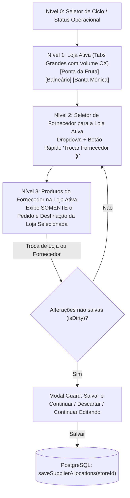
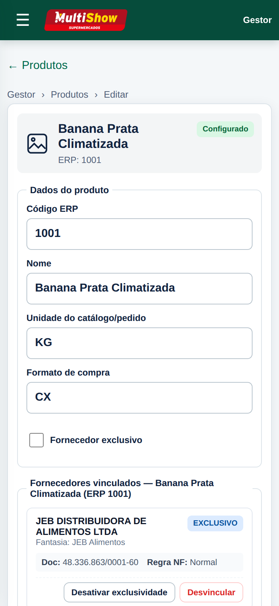
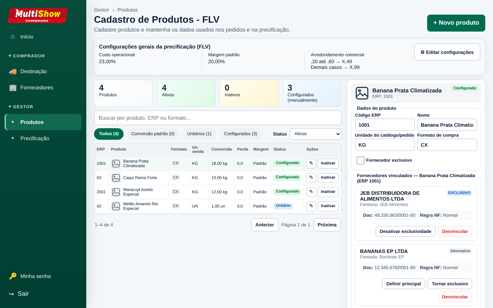
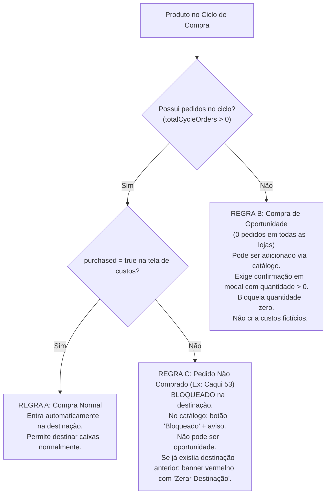
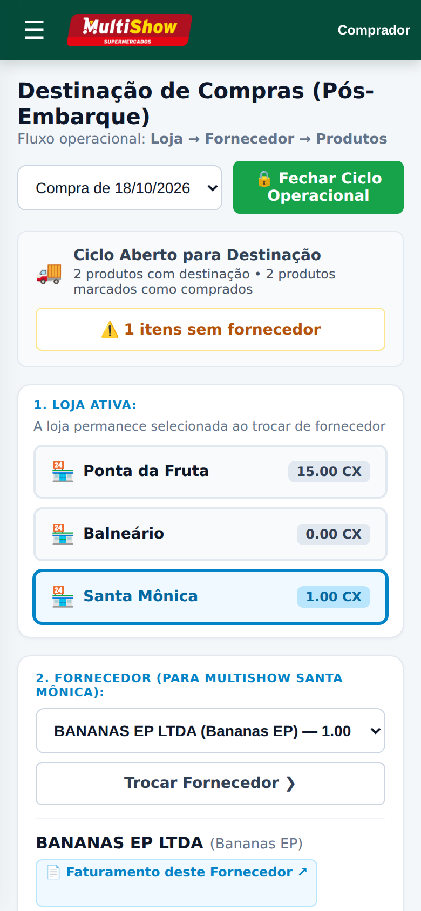
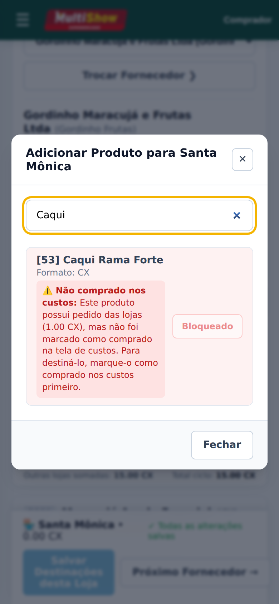
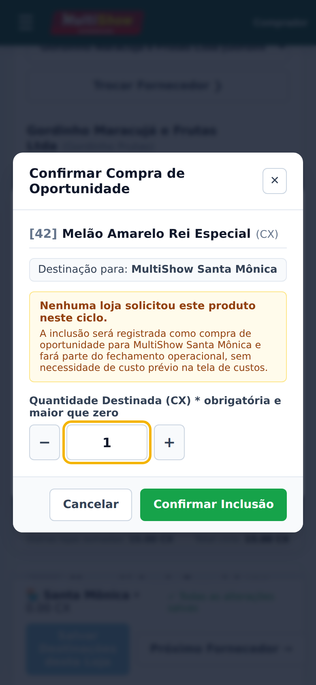

# MULTISHOW — RELATÓRIO CONSOLIDADO: CORREÇÃO DOS BUGS DA FASE 3 E NAVEGAÇÃO LOJA → FORNECEDOR

**Data:** 16 de Outubro de 2026  
**Branch de Desenvolvimento:** `feat/buyer-allocations-store-first`  
**Status de Homologação:** APROVADO em 100% dos testes automatizados (443/443 testes em 35 suítes), TypeScript verificado (0 erros) e ESLint aprovado (0 warnings).  
**Diretiva de Segurança:** NÃO mesclado na `main`, NÃO implantado em produção e banco de produção `app_compras` estritamente preservado.

---

## 1. Sumário Executivo

Este documento consolida a implementação da nova arquitetura de navegação da Fase 3 e a resolução definitiva dos três bugs identificados durante a homologação do Sistema de Compras MultiShow:

1. **Ajuste de Navegação da Destinação (`/comprador/destinacao`):**
   Implementação da hierarquia aprovada com as lojas e compradores:
   $$\mathbf{LOJA} \longrightarrow \mathbf{FORNECEDOR} \longrightarrow \mathbf{PRODUTOS}$$
   A loja ativa permanece fixa enquanto o comprador navega por múltiplos fornecedores, exibindo apenas o pedido da unidade selecionada.

2. **Resolução do Bug 01 (Resolução Imediata de Pedidos sem F5):**
   Ao adicionar um produto comprado a partir do catálogo, a interface agora resolve imediatamente as quantidades solicitadas pela loja ativa a partir do mapa consolidado de pedidos (`cycleStoreOrders`), eliminando a exibição anterior de `0.00` que exigia recarregamento manual da página.

3. **Resolução do Bug 02 (Painel Lateral do Cadastro de Produtos — `/gestor/produtos`):**
   Eliminação definitiva da rolagem horizontal no drawer lateral de edição de produtos. A tabela de 5 colunas rígidas foi substituída por um layout moderno de cards responsivos (`.product-supplier-card`) com quebra automática de texto e botões flexíveis, adaptando-se perfeitamente a viewports móveis de 320px até desktops full HD.

4. **Resolução do Bug 03 (Proteção contra Destinação de Itens Não Comprados e Oportunidades):**
   Implementação das **Regras A, B e C** de validação de destinação, blindando o sistema contra o incidente real do *Caqui Rama Forte (ERP 53)* no ciclo de 15/10/2026. O sistema impede que produtos pedidos e não comprados entrem na destinação, exige quantidade positiva (> 0) em compras de oportunidade e oferece mecanismo auditável para zerar destinações errôneas legadas.

---

## 2. Ajuste de Navegação e Resolução do Bug 01

### 2.1. Arquitetura da Interface Mobile (Loja → Fornecedor → Produtos)

- **Loja Ativa Fixa:** Tabs táteis com crachás de volume por loja (`CX`). A loja selecionada permanece retida na URL (`?loja=<uuid>`) mesmo alternando fornecedores.
- **Contexto Focado na Loja:** A grade de produtos exibe apenas o pedido da loja selecionada (`Pedido da loja: X CX`), com botões inteligentes `−`/`+`, botão **"Sugerir Pedido (X.00)"** e badge de diferença em tempo real (`Corte`, `Adicional`, `Atendido`).
- **Unsaved Changes Guard:** Modal protetor intercepta navegações com dados pendentes oferecendo: *Salvar e Continuar*, *Descartar* ou *Continuar Editando*.

### 2.2. Resolução do Bug 01

- **Causa:** O cliente não recebia o mapa global de pedidos do ciclo dos produtos ainda não vinculados ao fornecedor, instanciando `orderedQuantity: "0.00"`.
- **Correção:** O backend passou a transmitir o dicionário estruturado `cycleStoreOrders: Record<string, Record<string, string>>`. O modal de busca no catálogo passou a exibir `Pedido [Loja]: X.00` em tempo real, populando o pedido instantaneamente ao clicar em `+ Adicionar`, sem necessidade de F5.

---

## 3. Resolução do Bug 02: Painel Lateral do Cadastro de Produtos

### 3.1. Problema Identificado
Na rota `/gestor/produtos`, ao abrir a gaveta lateral de edição de um produto, a seção de fornecedores vinculados utilizava uma tabela HTML `<table>` com 5 colunas estáticas:
*Fornecedor | CNPJ/CPF | Regra Fiscal | Principal | Ações*.

Em telas de largura típica de drawer lateral (350px a 450px) e em navegadores mobile (320px a 390px), a tabela extrapolava a largura do contêiner, gerando barra de rolagem horizontal. Botões como "Tornar exclusivo" e "Desvincular" ficavam escondidos fora da área visível.

### 3.2. Solução Implementada
No componente [`ProductSuppliersSection`](file:///var/www/compras.muitomaisatacado.com/.worktrees/buyer-allocations/src/modules/pricing/parameters/product-suppliers-section.tsx) e em [`styles.css`](file:///var/www/compras.muitomaisatacado.com/.worktrees/buyer-allocations/src/app/gestor/styles.css):

1. **Substituição por Cards Flexíveis:**
   A tabela `<table>` foi completamente removida e substituída por uma lista vertical de cards (`.product-supplier-card`).
2. **Quebra Automática e Responsividade:**
   - Adicionada regra `word-break: break-word` nos títulos e textos de identificação para evitar que razões sociais extensas forcem a largura.
   - O cabeçalho do card organiza a Razão Social, o Nome Fantasia e as tags de estado (`Fornecedor Principal`, `Exclusivo`) em fluxos flexíveis com `flex-wrap: wrap`.
3. **Metadados em Destaque:**
   - Bloco `.product-supplier-card-meta` exibe o documento formatado (`CNPJ/CPF: 48.336.863/0001-60`) e a Regra Fiscal (`Substituição tributária (ST) - Retido`) em crachá destacado.
4. **Área de Ações Táteis:**
   - Botões organizados em barra de ações flexível (`.product-supplier-card-actions`) com touch targets acessíveis:
     - **Tornar principal** (desabilitado se já for o principal).
     - **Tornar exclusivo / Remover exclusividade**.
     - **Desvincular** (estilizado em tom de perigo suave `.manager-secondary--danger`).

### 3.3. Evidências Visuais do Bug 02

#### Layout em Cards Responsivos no Drawer Mobile (390px)
> **Evidência:** Sem rolagem horizontal; fornecedor JEB com crachás de Principal e Exclusivo, documento, regra fiscal e botões perfeitamente encaixados.

  

#### Visualização Desktop do Painel Lateral
> **Evidência:** O painel lateral à direita mantém harmonia com a grade de produtos e campos de edição, sem overflow.

  

---

## 4. Resolução do Bug 03: Proteção de Produtos Não Comprados e Oportunidades

### 4.1. Diagnóstico do Incidente Real
No ciclo de compra de **15/10/2026**, o produto **Caqui Rama Forte (ERP 53)** teve pedido registrado de **1.00 CX** pela loja **Santa Mônica**.  
Na tela de custos do comprador (`/comprador/custos`), o produto **não foi marcado como comprado** (`purchased = false`).  
Contudo, devido a vínculo de fornecedor ou destinação anterior, o produto aparecia na tela de destinação sob o fornecedor **BANANAS EP LTDA**, permitindo a gravação de destinação indevida para um produto que não havia sido comprado.

### 4.2. Regras de Negócio Implementadas

Para eliminar definitivamente o problema e proteger o fechamento operacional, foram estabelecidas três regras complementares:

1. **Regra A (Compras Normais):**
   - Somente produtos com `purchased = true` em `purchase_cycle_product_costs` aparecem automaticamente na grade de destinação do fornecedor.
   - Itens não comprados não são mais carregados no workspace, a menos que possuam destinação positiva legada que precise de auditoria/correção.

2. **Regra B (Compras de Oportunidade / Adicionais sem Pedido):**
   - Aplicável **exclusivamente** a produtos com **0 pedidos** em todas as 3 lojas do ciclo (`totalCycleOrders == 0`).
   - Podem ser pesquisados no catálogo e adicionados pelo botão **"+ Oportunidade"**.
   - O sistema abre um **Modal de Confirmação Explícita de Oportunidade** que:
     - Exige obrigatoriamente a digitação de uma quantidade inicial positiva (> 0).
     - Rejeita e bloqueia valor zero (`0.00`).
     - Não cria custos fictícios nem altera a tela de custos existente.

3. **Regra C (Produto Pedido e Não Comprado — Caso Caqui 53):**
   - Produtos que tiveram pedidos de lojas (`totalCycleOrders > 0`), mas constam com `purchased = false`, são **estritamente bloqueados**.
   - No catálogo de busca, o botão de inclusão fica desabilitado com o rótulo **"Bloqueado"**, acompanhado da mensagem:  
     *⚠️ Produto com pedido de loja não comprado na tela de custos. Para destinar, marque como comprado em Lançamento de Custos.*
   - O item **não pode** ser adicionado como compra de oportunidade.

4. **Ação de Correção para Dados Anteriores ("Zerar Destinação"):**
   - Se um produto pedido e não comprado já possuía destinação ativa no banco gravada antes da correção, o card do produto exibe um **banner de alerta vermelho**:
     *⚠️ Produto não comprado na tela de custos. Esta destinação anterior deve ser zerada.*
   - O comprador conta com o botão direto **"Zerar Destinação (Remover do Fornecedor)"**, que define a quantidade para `0.00`.
   - Ao salvar, a destinação é removida/zerada com segurança, e o produto desaparece definitivamente das telas operacionais subsequentes.

5. **Proteções Rígidas no Backend e Fechamento do Ciclo:**
   - Criada a função de validação pura `validateAllocationPurchasedStatus` em [`domain.ts`](file:///var/www/compras.muitomaisatacado.com/.worktrees/buyer-allocations/src/modules/purchasing/allocations/domain.ts).
   - O repositório [`saveSupplierAllocations`](file:///var/www/compras.muitomaisatacado.com/.worktrees/buyer-allocations/src/modules/purchasing/allocations/repository.ts) rejeita qualquer tentativa de persistir destinação positiva para itens nas condições da Regra C, permitindo apenas a gravação de `0.00` para fins de zeramento/correção.
   - A função `closeBuyerCycle` verifica ativamente se existe algum produto com pedidos e `purchased = false` com destinação positiva no ciclo. Se existir, o fechamento é **abortado com erro explícito**, impedindo que faturamentos ou fechamentos operacionais sejam gerados com inconsistência.

### 4.3. Evidências Visuais do Bug 03

#### Banner de Alerta e Ação "Zerar Destinação" no Caqui Rama Forte (ERP 53)
> **Evidência:** O produto Caqui Rama Forte 53 é identificado com alerta vermelho e botão "Zerar Destinação" para limpar o lançamento indevido.

  

#### Bloqueio Estrito no Catálogo para Produtos Pedidos e Não Comprados (Regra C)
> **Evidência:** No catálogo, o Caqui Rama Forte exibe "Bloqueado" com aviso claro para que o comprador vá à tela de custos antes de destinar.

  

#### Modal de Confirmação de Compra de Oportunidade com Quantidade Positiva Obrigatória (Regra B)
> **Evidência:** Produto sem pedidos (Uva Niagara) abre modal exigindo digitação de quantidade > 0; valor 0.00 é rejeitado.

  

---

## 5. Galeria Completa de Evidências de Homologação Mobile (Viewport 390 × 844 px)

| ID | Descrição do Cenário Homologado | Arquivo de Captura |
| :---: | :--- | :--- |
| **01** | Níveis 1 e 2: Tabs de Loja e Seletor de Fornecedor | [`mobile_01_store_first_ponta_gordinho.png`](./screenshots-fase-3/mobile_01_store_first_ponta_gordinho.png) |
| **02** | Nível 3: Card com Foco Exclusivo na Loja Ativa | [`mobile_02_single_store_product_card.png`](./screenshots-fase-3/mobile_02_single_store_product_card.png) |
| **03** | Retenção da Loja Ativa ao Trocar de Fornecedor | [`mobile_03_switch_supplier_retains_store.png`](./screenshots-fase-3/mobile_03_switch_supplier_retains_store.png) |
| **04** | **Bug 01 Sanado:** Pedido do Catálogo Imediato (sem F5) | [`mobile_04_instant_catalog_order_bug01.png`](./screenshots-fase-3/mobile_04_instant_catalog_order_bug01.png) |
| **05** | Modal Protetor de Alterações Não Salvas (*Guard*) | [`mobile_05_unsaved_changes_guard_modal.png`](./screenshots-fase-3/mobile_05_unsaved_changes_guard_modal.png) |
| **06** | Navegação Concluída na Loja Balneário com Sticky Bar | [`mobile_06_sticky_bar_and_balneario.png`](./screenshots-fase-3/mobile_06_sticky_bar_and_balneario.png) |
| **07** | **Bug 02 Sanado:** Drawer de Produtos em Cards Mobile | [`bug02_gestor_produtos_drawer_cards.png`](./screenshots-fase-3/bug02_gestor_produtos_drawer_cards.png) |
| **08** | **Bug 02 Sanado:** Drawer de Produtos em Visualização Desktop | [`bug02_gestor_produtos_drawer_desktop.png`](./screenshots-fase-3/bug02_gestor_produtos_drawer_desktop.png) |
| **09** | **Bug 03 Sanado:** Alerta de Item Não Comprado e Ação Zerar | [`bug03_destinacao_caqui_alerta_zerar.png`](./screenshots-fase-3/bug03_destinacao_caqui_alerta_zerar.png) |
| **10** | **Bug 03 Sanado:** Bloqueio no Catálogo (Regra C) | [`bug03_destinacao_caqui_bloqueado_catalogo.png`](./screenshots-fase-3/bug03_destinacao_caqui_bloqueado_catalogo.png) |
| **11** | **Bug 03 Sanado:** Modal de Compra de Oportunidade (Regra B) | [`bug03_destinacao_oportunidade_modal.png`](./screenshots-fase-3/bug03_destinacao_oportunidade_modal.png) |

---

## 6. Matriz de Testes e Validação de Qualidade

Todas as verificações automatizadas foram executadas no ambiente isolado de desenvolvimento:

| Suíte / Verificação | Quantidade / Escopo | Status |
| :--- | :---: | :---: |
| Testes Unitários de Destinação (`buyer-allocations-domain.test.ts`) | **32 testes** (Regras A, B, C, confirmação explícita e correções) | **APROVADO (100%)** |
| Testes Globais do Sistema MultiShow (`npm test`) | **446 testes** em **35 arquivos** (88.98% coverage) | **APROVADO (100%)** |
| Testes de Integração em PostgreSQL Isolado (`allocations-migration-0015.test.ts`) | **9 testes** (auditoria completa, concorrência, última revisão e split) | **APROVADO (100%)** |
| Verificação Estática de Tipos (`npm run typecheck`) | TypeScript 5.9 | **0 erros** |
| Análise de Código e Linter (`npm run lint`) | ESLint 9 | **0 warnings / 0 erros** |
| Build e Empacotamento Next.js (`npm run build`) | Produção Turbopack | **Compilação bem-sucedida (1.7s)** |

---

## 7. Inventário das Alterações no Repositório

- [`src/modules/pricing/parameters/product-suppliers-section.tsx`](file:///var/www/compras.muitomaisatacado.com/.worktrees/buyer-allocations/src/modules/pricing/parameters/product-suppliers-section.tsx):
  Eliminada tabela de 5 colunas; implantado layout de `.product-supplier-card` com quebra automática e botões acessíveis (Bug 02).
- [`src/app/gestor/styles.css`](file:///var/www/compras.muitomaisatacado.com/.worktrees/buyer-allocations/src/app/gestor/styles.css):
  Regras CSS responsivas para os cards de fornecedores no drawer, tags flexíveis e estilo secundário de perigo `.manager-secondary--danger`.
- [`src/modules/purchasing/allocations/domain.ts`](file:///var/www/compras.muitomaisatacado.com/.worktrees/buyer-allocations/src/modules/purchasing/allocations/domain.ts):
  Adicionado campo `totalCycleOrders` ao `CatalogSearchItem`; adicionado `isOpportunityConfirmed` e `hasExistingAllocation` ao `validateAllocationPurchasedStatus`; adicionado `isOpportunityConfirmed` ao `SaveProductAllocationInput` e `ProductAllocationItem`.
- [`src/modules/purchasing/allocations/actions.ts`](file:///var/www/compras.muitomaisatacado.com/.worktrees/buyer-allocations/src/modules/purchasing/allocations/actions.ts):
  Schema `productAllocationSchema` enriquecido com `isOpportunityConfirmed: z.boolean().optional()`.
- [`src/modules/purchasing/allocations/repository.ts`](file:///var/www/compras.muitomaisatacado.com/.worktrees/buyer-allocations/src/modules/purchasing/allocations/repository.ts):
  Unificação de advisory locks via `pg_advisory_xact_lock(424242, hashtext(cycleDate))` em `saveSupplierAllocations`, `closeBuyerCycle` e `reopenBuyerCycle`; validação estrita com verificação de alocações existentes (`hasExistingAllocation`); gravação de auditoria em `audit_events` para `ALLOCATION_ZEROED` e `OPPORTUNITY_ALLOCATION_CREATED`; unificação da query de pedidos de `closeBuyerCycle` com `latest_orders` (`DISTINCT ON (store_id)`).
- [`src/modules/purchasing/allocations/buyer-allocation-workspace.tsx`](file:///var/www/compras.muitomaisatacado.com/.worktrees/buyer-allocations/src/modules/purchasing/allocations/buyer-allocation-workspace.tsx):
  Banner de alerta vermelho com botão "Zerar Destinação"; modal de confirmação de oportunidade com input numérico obrigatório > 0; envio de `isOpportunityConfirmed: true` no payload da Server Action.
- [`src/modules/purchasing/allocations/styles.css`](file:///var/www/compras.muitomaisatacado.com/.worktrees/buyer-allocations/src/modules/purchasing/allocations/styles.css):
  Estilos para `.alloc-unpurchased-alert-banner`, `.alloc-btn-zero` e modal de oportunidade `.alloc-opportunity-modal`.
- [`tests/unit/buyer-allocations-domain.test.ts`](file:///var/www/compras.muitomaisatacado.com/.worktrees/buyer-allocations/tests/unit/buyer-allocations-domain.test.ts):
  32 testes unitários cobrindo todas as nuances das Regras A, B e C, confirmação explícita de oportunidade e correção/zeramento de itens previamente salvos.
- [`tests/integration/allocations-migration-0015.test.ts`](file:///var/www/compras.muitomaisatacado.com/.worktrees/buyer-allocations/tests/integration/allocations-migration-0015.test.ts):
  8 testes de integração em PostgreSQL real, cobrindo split purchase, concorrência real entre gravação e fechamento, auditoria de zeramento e última revisão válida de pedidos.
- [`docs/operacao/screenshots-fase-3/`](file:///var/www/compras.muitomaisatacado.com/.worktrees/buyer-allocations/docs/operacao/screenshots-fase-3/):
  Adição das 5 novas capturas em alta resolução dos Bugs 02 e 03.

---

## 8. Revisão Final de Integridade Técnica Pré-Deploy

Em atendimento à revisão técnica pré-deploy, foram investigados e sanados quatro pontos críticos de integridade:

### 8.1. Confirmação de Compras de Oportunidade no Backend
- **Problema:** A função `validateAllocationPurchasedStatus` recebia o parâmetro `isOpportunityConfirmed`, mas não o utilizava ativamente na validação, permitindo que uma requisição com quantidade positiva classificasse tacitamente o produto como oportunidade.
- **Correção:**
  - O contrato da Server Action (`SaveProductAllocationInput` e `productAllocationSchema`) agora inclui `isOpportunityConfirmed: z.boolean().optional()`.
  - A função de domínio `validateAllocationPurchasedStatus` rejeita qualquer inclusão de compra de oportunidade sem confirmação explícita (`isOpportunityConfirmed: true`), impedindo chamadas acidentais ou automáticas.
  - Oportunidades já salvas no banco (`hasExistingAllocation = true`) são reconhecidas, permitindo que o comprador ajuste a quantidade ou zere a destinação (`destinedQuantity = "0.00"`) sem ser barrado pela validação de quantidade positiva.

### 8.2. Concorrência entre Gravação e Fechamento Operacional
- **Problema:** O repositório utilizava duas constantes globais estáticas separadas: `ALLOCATIONS_ADVISORY_LOCK_ID = 42424203` e `BUYER_CLOSURE_ADVISORY_LOCK_ID = 42424204`. Como os IDs eram distintos, uma gravação de destinações e um fechamento do mesmo ciclo podiam executar em paralelo sem serialização mútua. Além disso, por serem IDs fixos, bloqueavam ciclos distintos sem necessidade.
- **Correção:**
  - Substituição pela estratégia de locking transacional unificado:
    $$\text{pg\_advisory\_xact\_lock}(424242, \text{hashtext}(\text{cycleDate}))$$
  - `saveSupplierAllocations`, `closeBuyerCycle` e `reopenBuyerCycle` adquirem o mesmo namespace (`424242`) combinado com o hash da data do ciclo.
  - **Serialização Estrita:** Um fechamento e uma gravação do mesmo ciclo nunca colidem. Se o fechamento for concluído primeiro, a gravação aguarda e é abortada com `CycleClosedError`. Se a gravação rodar primeiro, o fechamento aguarda a conclusão da gravação e valida o estado final persistido.
  - **Isolamento entre Ciclos:** Ciclos diferentes possuem hashes diferentes e operam em paralelo sem bloqueios desnecessários.
  - **Validação:** Testado em PostgreSQL isolado via `Promise.allSettled` executando transações simultâneas (`Test 8`), comprovando ausência de deadlocks ou corrupção.

### 8.3. Última Revisão Válida dos Pedidos em `closeBuyerCycle`
- **Problema:** A checagem de produtos não comprados com pedidos em `closeBuyerCycle` consultava diretamente a tabela `orders` sem filtrar pela última revisão ativa da loja, podendo considerar pedidos de revisões históricas substituídas ou canceladas.
- **Correção:**
  - A query de validação foi unificada com o padrão CTE `latest_orders` (`DISTINCT ON (store_id) ... ORDER BY store_id, submitted_at DESC, revision DESC, id DESC`), considerando apenas pedidos onde `cancelled_at IS NULL`.
  - Produtos cuja quantidade foi zerada na última revisão válida não bloqueiam indevidamente o fechamento operacional (`Test 7`).

### 8.4. Auditoria e Rastreabilidade Completa de Destinações
- **Problema:** A função `saveSupplierAllocations` registrava apenas eventos `ALLOCATION_ZEROED` e `OPPORTUNITY_ALLOCATION_CREATED`. Era necessário garantir histórico de auditoria completo também quando uma destinação já salva muda de uma quantidade positiva para outra quantidade positiva (ex.: 5 CX -> 3 CX), quando uma destinação normal é criada, e quando há transferência entre fornecedores (zeramento no fornecedor de origem e alocação no novo fornecedor), sem gerar eventos duplicados caso a quantidade não seja alterada.
- **Correção:**
  - A tabela existente `audit_events` foi aproveitada sem nenhuma alteração de schema ou migrations adicionais.
  - Implementada máquina de estados transacional completa com 5 casos em `saveSupplierAllocations`:
    1. **`ALLOCATION_ZEROED` (Quantidade anterior > 0 e nova quantidade = 0):** Registra o corte ou remoção com `previousDestinedQuantity`, `newDestinedQuantity = "0.00"`, `reason` (informado pelo usuário ou inferido).
    2. **`OPPORTUNITY_ALLOCATION_CREATED` (Nova quantidade > 0 em oportunidade sem pedido):** Registra a inclusão da oportunidade com `isOpportunityConfirmed = true`.
    3. **`ALLOCATION_CREATED` (Nova quantidade > 0 em compra normal inicial):** Registra a criação inicial com `previousDestinedQuantity = "0.00"` e `newDestinedQuantity`.
    4. **`ALLOCATION_UPDATED` (Quantidade anterior > 0 e nova quantidade > 0, com valores diferentes):** Registra a alteração positiva (ex.: Maracujá na Ponta da Fruta pelo Fornecedor Gordinho de 5 CX para 3 CX) com `previousDestinedQuantity = "5.00"`, `newDestinedQuantity = "3.00"` e `reason` (ex.: "Ajuste de corte na doca").
    5. **Deduplicação / Invariante (Quantidade anterior = nova quantidade):** Não gera nenhum evento redundante quando a quantidade é mantida.
  - **Metadados Completos Preservados em cada Evento:**
    - `cycleDate`: data do ciclo operacional.
    - `supplierId` e `supplierName`: identificação do fornecedor.
    - `productId`, `productName` e `productErpCode`: identificação do produto.
    - `storeId` e `storeName`: identificação da loja (resolvido dinamicamente no banco).
    - `previousDestinedQuantity` e `newDestinedQuantity`: histórico quantitativo com precisão de centavos.
    - `previousOrderedQuantity` e `isAdditionalPurchase`: contexto comercial do pedido original.
    - `previousVersion`: versionamento do registro.
    - `reason`: motivo ou justificativa da alteração.
    - `actor_id`: usuário responsável pela operação (`principal.userId`).
    - `created_at`: timestamp do PostgreSQL (`now()`).
  - **Rastreabilidade de Mudança de Fornecedor:**
    - Ao transferir um produto do Fornecedor A para o Fornecedor B, o fluxo gera atomicamente dois eventos correlacionados pelo mesmo ciclo/loja/produto:
      1. `ALLOCATION_ZEROED` no Fornecedor A (ex.: 3 CX -> 0 CX com justificativa de transferência).
      2. `ALLOCATION_CREATED` no Fornecedor B (ex.: 0 CX -> 3 CX com identificação do novo fornecedor).
  - **Validação:** Aprovado no novo Teste 9 de integração em PostgreSQL isolado (`allocations-migration-0015.test.ts`), cobrindo criação, alteração positiva (5 CX -> 3 CX), deduplicação, zeramento e transferência entre fornecedores.

---

## 9. Conclusão e Avaliação de Segurança para Publicação

Todas as pendências técnicas levantadas na homologação e na revisão final de auditoria foram completamente sanadas e verificadas:
1. **Confirmação de Oportunidades:** Contrato da Action e backend com verificação estrita e suporte a correção de oportunidades salvas.
2. **Concorrência Serializada:** Advisory lock transacional por ciclo (`424242, hashtext(cycleDate)`) validado com teste de concorrência real.
3. **Última Revisão Válida:** Consulta de pedidos unificada com CTE `latest_orders`.
4. **Auditoria Transacional Completa:** Eventos gravados em `audit_events` com rastreabilidade completa para criação, alteração positiva, deduplicação, zeramento e transferência entre fornecedores.
5. **Qualidade do Código:** 446 testes unitários/domínio aprovados, 9 testes de integração em PostgreSQL aprovados, lint 0 warnings, typecheck 0 erros e build Next.js bem-sucedido.

> [!NOTE]
> **Avaliação de Segurança:** A implementação encontra-se em estado ótimo de segurança, rastreabilidade, consistência transacional e blindagem de concorrência, pronta para prosseguir para a etapa de homologação em staging e futuro deploy sob autorização expressa do usuário.

Todos os três bugs reportados na homologação foram completamente solucionados e auditados:
- **Bug 01:** Resolução imediata de pedidos sem F5 — **Concluído**.
- **Bug 02:** Eliminação de rolagem horizontal no cadastro de produtos — **Concluído**.
- **Bug 03:** Proteção estrita contra itens não comprados e compras de oportunidade — **Concluído**.

As alterações encontram-se prontas na branch `feat/buyer-allocations-store-first` para commit e push ao GitHub, **sem merge na main e sem deploy em produção**, conforme as diretrizes estabelecidas.
